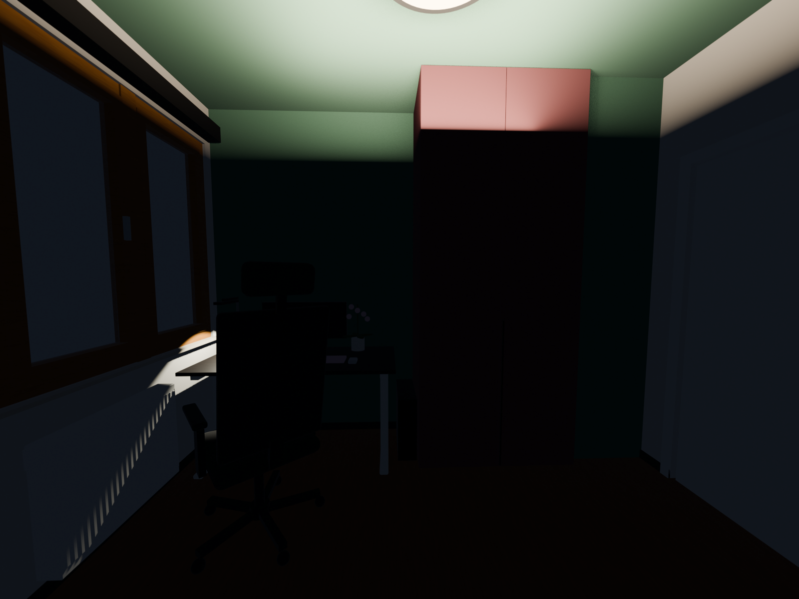

# Study restyle

A 3D planner for a 276 × 334 cm study with a 2.7 m ceiling. Drag the room around, pick a style and a desk layout, choose a version of each piece (lights, desk and its length, chair, wardrobe, window, rug, art, shelves, the door corner, the wall opposite the desk, plants, dividers), and toggle about 50 add-ons. Click a piece of furniture to drag it around or rotate it. The panel keeps a rough cost estimate in Polish złoty.

**Live:** https://aleqsio.github.io/study-restyle/

The whole setup is saved in the page's `#` link, so a copied link reopens the same room.



## How it's built

Everything is modelled in Blender from simple boxes, cylinders and spheres, to scale.

| File | What it does |
| --- | --- |
| `build_room.py` | The room as it is today: walls, window, door, radiator, wardrobe, desk, chair. Writes `room.blend` and two preview renders. |
| `catalog.py` | Low-poly models for every option (run by `restyle_export.py`). |
| `restyle_export.py` | Adds the options to the room, tags them for the viewer, and exports `viewer/room.json` (a gzipped GLB in a JSON wrapper). |
| `viewer/index.html` | The three.js viewer. No build step. |

Rebuild the model (Blender 5.x):

```bash
blender --background --python build_room.py
blender --background room.blend --python restyle_export.py
```

Both scripts write their output next to themselves.

View it locally:

```bash
python3 -m http.server 8765 --directory viewer
```

Pushing to `main` redeploys GitHub Pages from `viewer/`.
